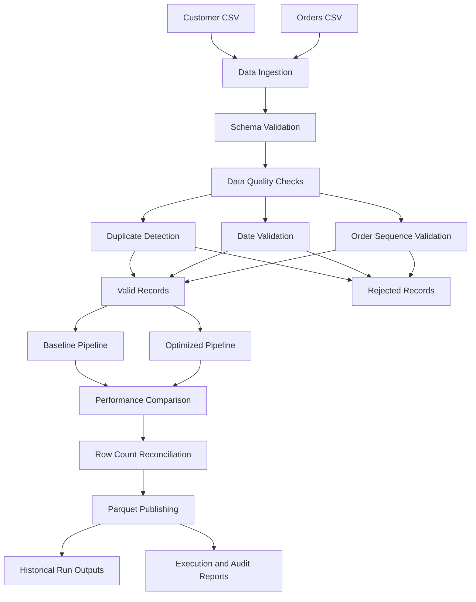

# PySpark Performance Engineering

A reusable PySpark ETL framework demonstrating scalable data ingestion, data quality validation, record quarantine, transformation, performance optimization, execution monitoring, audit reporting, and historical Parquet publishing.

## 1. Project Overview

This project processes customer and order datasets using Apache Spark.

It implements two pipeline strategies:

- **Baseline pipeline:** Standard DataFrame joins and transformations.
- **Optimized pipeline:** Broadcast joins to reduce shuffle overhead when joining a relatively small customer dataset with orders.

Both pipelines share the same data-quality rules and transformation logic to ensure consistent results.

Key capabilities:

- Schema-based CSV ingestion.
- Customer and order validation.
- Duplicate customer and order detection.
- Strict date validation.
- Out-of-order order detection.
- Invalid-record quarantine with rejection reasons.
- Baseline versus optimized performance comparison.
- Output row-count reconciliation.
- JSON execution and audit reports.
- Failure reporting.
- Run-specific historical Parquet outputs.
- Automated tests using Pytest.

## 2. Architecture



## 3. Technology Stack

- Python 3.12
- Apache PySpark 3.5.5
- Spark SQL and DataFrames
- Pytest
- Java 17
- CSV and Parquet
- Git and GitHub

## 4. Project Structure

```text
pyspark-performance-engineering/
├── business/
│   ├── baseline.py
│   ├── customer_deduplication.py
│   ├── data_quality.py
│   ├── date_validation.py
│   ├── ingestion.py
│   ├── metrics.py
│   ├── optimized.py
│   ├── order_sequence_validation.py
│   ├── publishing.py
│   ├── transformations.py
│   └── validation.py
│
├── data/
│   ├── generator/
│   │   └── generate_data.py
│   ├── input/
│   │   ├── customers.csv
│   │   └── orders.csv
│   └── output/
│       ├── runs/
│       └── reports/
│
├── presentation/
│   ├── audit_report.py
│   ├── config.py
│   ├── main.py
│   └── report.py
│
├── tests/
│   ├── test_date_validation.py
│   ├── test_edge_cases.py
│   ├── test_order_sequence.py
│   └── test_pipeline.py
│
├── requirements.txt
├── .gitignore
└── README.md
```

## 5. Dataset Design

### Customers

| Column | Description |
|---|---|
| customer_id | Customer identifier |
| customer_name | Customer name |
| email | Customer email |
| city | Customer city |
| registration_date | Customer registration date |

### Orders

| Column | Description |
|---|---|
| order_id | Order identifier |
| customer_id | Customer reference |
| order_date | Order date |
| amount | Order amount |
| status | Order status |

## 6. Data Quality and Validation

The framework implements multiple validation layers.

### Customer validation

- Missing and invalid customer IDs.
- Missing customer names.
- Invalid email values.
- Missing registration dates.
- Duplicate customer IDs.

All records sharing a duplicate non-null customer ID are quarantined.

### Order validation

- Missing or invalid order IDs.
- Duplicate order IDs.
- Invalid customer references.
- Invalid order amounts.
- Unsupported order statuses.
- Invalid order dates.
- Out-of-order records.

### Strict date validation

Dates must follow the `yyyy-MM-dd` format and represent valid calendar dates.

Invalid and impossible dates are quarantined.

### Out-of-order detection

A Spark window function compares each customer's order date with the preceding order date.

The current implementation uses increasing `order_id` as the expected sequence for each customer.

Records with a date earlier than the preceding order are quarantined.

### Rejection handling

Invalid records are retained separately with rejection reasons, rather than silently discarded.

## 7. Performance Optimization

The optimized pipeline uses Spark broadcast joins for customer lookups.

Example:

```python
from pyspark.sql.functions import broadcast

result = orders.join(
    broadcast(customers),
    on="customer_id",
    how="inner"
)
```

Broadcast joins can reduce shuffle overhead when one side of a join is sufficiently small to fit in executor memory.

The framework measures baseline and optimized execution time and compares output record counts.

Performance depends on dataset size, cluster resources, Spark configuration, and JVM warm-up. Local benchmark results are illustrative and are not a general performance guarantee.

## 8. Installation

Requirements:

- Python 3.12
- Java 17
- Git

Create and activate a virtual environment:

```powershell
python -m venv venv
.\venv\Scripts\Activate.ps1
```

Install dependencies:

```powershell
pip install -r requirements.txt
```

## 9. Generate Test Data

Generate sample data:

```powershell
python -m data.generator.generate_data --customers 1000 --orders 5000 --seed 42
```

Generate a larger dataset:

```powershell
python -m data.generator.generate_data --customers 100000 --orders 500000 --seed 42
```

## 10. Run the Pipeline

Execute:

```powershell
python -m presentation.main
```

The application:

1. Loads customer and order CSV files.
2. Applies schemas and data-quality checks.
3. Separates valid and rejected records.
4. Executes baseline and optimized pipelines.
5. Measures execution time.
6. Reconciles output record counts.
7. Publishes optimized datasets as Parquet.
8. Generates execution and audit reports.
9. Preserves outputs using a unique run ID.
10. Generates failure reports when execution fails.

## 11. Output and Audit Reports

Each successful run creates a unique output directory.

```text
data/output/
├── runs/
│   └── <run_id>/
│       └── optimized/
│           ├── valid_customers/
│           ├── rejected_customers/
│           ├── valid_orders/
│           ├── rejected_orders/
│           ├── enriched_orders/
│           └── customer_summary/
│
└── reports/
    ├── execution_report.json
    └── audit_<run_id>.json
```

The execution report contains:

- Pipeline status.
- Execution timestamps.
- Baseline metrics.
- Optimized metrics.
- Performance comparison.
- Error information when execution fails.

The audit report contains:

- Unique run ID.
- Run status.
- Execution timestamps.
- Dataset record counts.
- Rejection breakdown by reason.
- Error information for failed runs.

Run-specific Parquet outputs and audit reports preserve historical execution data. The execution report represents the latest run.

## 12. Automated Testing

Run all tests:

```powershell
python -m pytest -v
```

The current test suite contains 10 passing tests covering:

- Customer validation.
- Order validation and quarantine.
- Duplicate customer detection.
- Strict date validation.
- Out-of-order order detection.
- Empty datasets.
- Required-field validation.
- Duplicate order handling.
- Customer references.
- Enrichment and aggregation.

## 13. Reconciliation

The application compares baseline and optimized record counts for:

- Valid customers.
- Rejected customers.
- Valid orders.
- Rejected orders.
- Enriched orders.
- Customer summary.

A mismatch raises an assertion error and marks the pipeline execution as failed.

## 14. Design Decisions and Trade-offs

- Explicit schemas avoid relying on CSV schema inference.
- DataFrame transformations use Spark SQL operations.
- Broadcast joins reduce shuffle overhead for suitable lookup datasets.
- Window functions support order-sequence validation.
- Quarantine preserves invalid records and rejection reasons.
- Parquet supports downstream analytical workloads.
- Run-specific output directories preserve previous results.
- Reconciliation verifies consistency between pipeline implementations.

## 15. Limitations and Future Improvements

- Add configurable event-time watermarking for late-arriving events.
- Add repeated benchmark runs and statistical performance comparisons.
- Add configurable partitioning and file-size optimization.
- Improve crash recovery and atomic publishing.
- Extend support to cloud storage and distributed Spark deployments.
- Add configurable data-quality rules.

## 16. Author

**Imran Pinjari**

Python | PySpark | SQL | Data Engineering | ETL | Performance Optimization