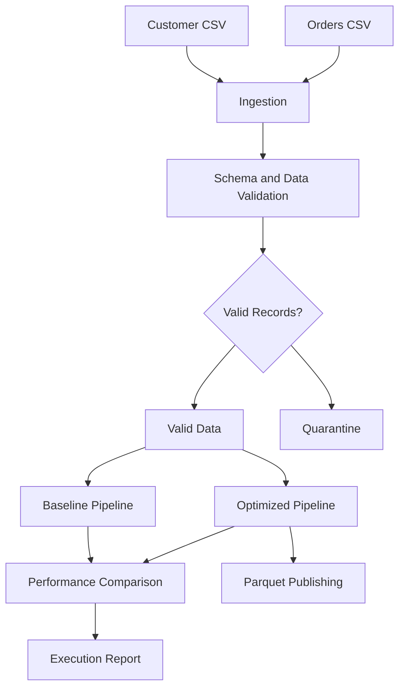

# PySpark Performance Engineering

A reusable PySpark ETL framework demonstrating data ingestion, validation, quarantine, transformation, performance optimization, reconciliation, and Parquet publishing.

## 1. Project Overview

This project processes customer and order datasets using Apache Spark.

It implements two pipeline strategies:

- Baseline pipeline: Standard DataFrame joins and transformations.
- Optimized pipeline: Broadcast joins to reduce shuffle overhead when joining a relatively small customer dataset with orders.

Both pipelines use the same validation and transformation rules to support output reconciliation.

## 2. Architecture



## 3. Technology Stack

- Python 3.12
- Apache PySpark 3.5.5
- Spark SQL and DataFrames
- Pytest
- CSV and Parquet

## 4. Project Structure

```text
pyspark-performance-engineering/
├── business/
│   ├── baseline.py
│   ├── ingestion.py
│   ├── metrics.py
│   ├── optimized.py
│   ├── publishing.py
│   ├── transformations.py
│   └── validation.py
├── data/
│   ├── generator/
│   │   └── generate_data.py
│   └── input/
│       ├── customers.csv
│       └── orders.csv
├── presentation/
│   ├── config.py
│   ├── main.py
│   └── report.py
├── tests/
│   └── test_pipeline.py
├── requirements.txt
├── .gitignore
└── README.md
```

## 5. Dataset Design

### Customers

| Column | Description |
|---|---|
| customer_id | Unique customer identifier |
| customer_name | Customer name |
| email | Customer email |
| city | Customer city |
| registration_date | Registration date |

### Orders

| Column | Description |
|---|---|
| order_id | Unique order identifier |
| customer_id | Customer reference |
| order_date | Order date |
| amount | Order amount |
| status | Order status |

### Data Assumptions

- Customer and order IDs must be positive.
- Customer email must contain @.
- Order amount must be greater than zero.
- Order status must be supported.
- Every order must reference a valid customer.
- Duplicate order IDs are quarantined.
- Invalid records are retained with rejection reasons.

## 6. Data Quality and Quarantine

The validation layer checks:

- Missing and invalid required fields.
- Invalid email values.
- Invalid order amounts.
- Duplicate order IDs.
- Invalid customer references.
- Unsupported order statuses.

Rejected records are stored separately with rejection reasons.

## 7. Performance Optimization

The optimized pipeline uses Spark broadcast joins for customer lookups.

Example:

```python
from pyspark.sql.functions import broadcast

result = orders.join(
    broadcast(customers),
    on="customer_id",
    how="inner"
)
```

Broadcast joins can reduce shuffle overhead when one side of a join is sufficiently small to fit in executor memory.

The project compares baseline and optimized execution time and reconciles output counts.

Performance depends on dataset size, cluster resources, Spark configuration, and JVM warm-up. Results from a small sample are illustrative, not a general performance guarantee.

## 8. Installation

Requirements:

- Python 3.12
- Java 17
- Git

Create and activate a virtual environment:

```powershell
python -m venv venv
.\venv\Scripts\Activate.ps1
```

Install dependencies:

```powershell
pip install -r requirements.txt
```

## 9. Generate Data

Generate reproducible sample data:

```powershell
python -m data.generator.generate_data --customers 1000 --orders 5000 --seed 42
```

Generate a larger dataset:

```powershell
python -m data.generator.generate_data --customers 100000 --orders 500000 --seed 42
```

## 10. Run the Pipeline

```powershell
python -m presentation.main
```

The application:

1. Loads customer and order CSV files.
2. Applies schemas and validation.
3. Separates valid and rejected records.
4. Executes baseline and optimized pipelines.
5. Measures execution time.
6. Reconciles output record counts.
7. Publishes optimized datasets as Parquet.
8. Writes an execution report in JSON format.

Output locations:

```text
data/output/optimized/
data/output/reports/execution_report.json
```

## 11. Run Automated Tests

```powershell
python -m pytest tests -v
```

Current automated tests cover:

- Customer validation.
- Order validation and quarantine.
- Enrichment and aggregation.

## 12. Reconciliation

The application compares baseline and optimized counts for:

- Valid customers.
- Rejected customers.
- Valid orders.
- Rejected orders.
- Enriched orders.
- Customer summary.

A mismatch raises an assertion error.

## 13. Design Decisions and Trade-offs

- Explicit schemas avoid relying on CSV schema inference.
- DataFrame transformations use Spark SQL operations.
- Broadcast joins are suitable for sufficiently small lookup datasets.
- Quarantine preserves invalid records and rejection reasons.
- Parquet supports downstream analytical workloads.
- Reconciliation checks output consistency.

## 14. Limitations and Future Improvements

- Expand automated tests for empty inputs, malformed records, and duplicate customer IDs.
- Add stronger date validation and late-arriving event handling.
- Add configurable partitioning and repeated benchmark runs.
- Improve failure recovery and run-level tracking.
- Extend support to cloud storage and distributed Spark deployments.

## 15. Author

Imran Pinjari

PySpark | Python | Data Engineering | Performance Optimization
